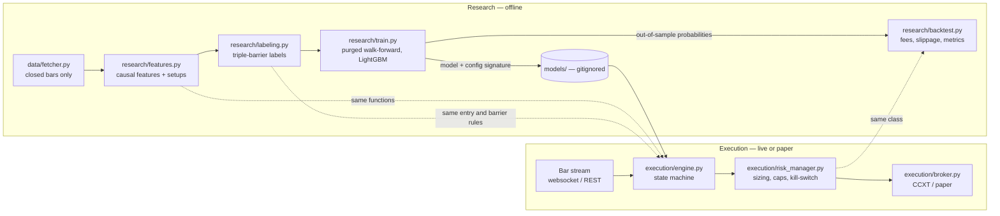

# Continuation Quant Bot

[](https://github.com/Goldengamer255/continuation-quant-bot/actions/workflows/ci.yml)

A machine-learning-filtered **continuation trading system** in Python: a leakage-controlled
research pipeline (features → triple-barrier labels → purged walk-forward training →
cost-aware backtest) and an async live execution engine that reuses the same code.

> **Disclaimer.** This is an engineering and research project, not financial advice. The
> committed configuration contains textbook placeholder values, not a tuned strategy. Nothing
> here is evidence of a profitable edge. Trading real money can lose all of it.

---

## 1. Hypothesis

A *continuation* is a three-stage price pattern:

1. **Impulse** — a sharp directional move on above-average volume. Someone large is
   trading aggressively.
2. **Consolidation** — price pauses in a tight range while volume fades. The aggressor
   rests and nobody is willing to push price back.
3. **Continuation** — price breaks out of the pause in the direction of the impulse.

**Claim under test:** not all impulse-plus-pause setups are equal. Measurable properties of
the setup — how strong the impulse was, how tight the pause is, how quickly volume decays,
and whether the trend regime agrees — carry information about whether a breakout will reach
a `+2 ATR` target before a `−1 ATR` stop.

A simple rule finds candidate setups and decides direction. A gradient-boosted classifier
then estimates the probability that each candidate wins, and only high-probability setups
are traded. This two-stage design is called **meta-labeling**: the model can veto trades
but never invents them.

With a 2:1 payoff, the break-even win rate is `1 / (1 + 2) = 33.3%` before costs. The model
does not need to be right most of the time; it needs to lift the win rate of the trades it
selects clearly above that line, by more than fees and slippage take away.

## 2. Architecture



The dotted lines are the point of the design: **research and live trading share code**
rather than re-implementing it. Features, setup detection, entry levels, barrier levels and
risk checks each exist exactly once.

```
continuation-quant-bot/
├── .github/workflows/ci.yml     # ruff + pytest on every push and PR
├── config/
│   └── settings.example.yaml    # public template (settings.yaml is gitignored)
├── core/
│   ├── config.py                # typed, validated settings; credentials from env only
│   └── logging_setup.py         # JSON structured logging
├── data/
│   ├── fetcher.py               # paginated OHLCV download, validation, parquet cache
│   └── synthetic.py             # offline data generator for tests and demos
├── research/
│   ├── features.py              # continuation features and setup detection
│   ├── labeling.py              # triple-barrier labels, uniqueness weights
│   ├── dataset.py               # chains features → setups → labels
│   ├── train.py                 # purged walk-forward validation, model persistence
│   └── backtest.py              # event-driven backtest with costs and risk limits
├── execution/
│   ├── risk_manager.py          # ATR sizing, exposure caps, kill-switch
│   ├── broker.py                # async CCXT wrapper, paper broker, replay feed
│   └── engine.py                # live bar listener and order router
├── tests/                       # 80 tests: leakage, labels, risk, costs, engine replay
├── docs/INTERVIEW_NOTES.md      # concept primer and design-decision Q&A
├── .env.example                 # credential template
├── Dockerfile
├── requirements.txt / requirements-dev.txt
└── pyproject.toml
```

## 3. How data leakage is prevented

Leakage — the model or backtest seeing information that would not have been available at
decision time — is the most common reason a backtest looks good and live trading does not.
Each stage has a specific control, and each control has a test.

| Stage | Risk | Control | Test |
|---|---|---|---|
| Data | Using the still-forming bar | Bars are dropped until `open_time + timeframe <= now` | `test_in_progress_bar_is_dropped` |
| Features | A feature peeks at future bars | Only backward `rolling` / `ewm` / positive `shift`; no global statistics | Features are recomputed on truncated and tampered history and must be identical |
| Labels | Label uses the setup bar or earlier | Entry is searched from bar `t+1`; barriers use ATR known at `t` | `test_labels_ignore_the_setup_bar_and_everything_before_it` |
| Validation | Training on trades that resolve inside the test period | Walk-forward splits; a sample trains only if `t1 + embargo < test_start` | `test_purge_removes_exactly_the_overlapping_samples` |
| Backtest | Scoring trades the model was trained on | Only out-of-sample walk-forward predictions are traded | `test_research_pipeline_end_to_end` |
| Whole pipeline | Something nobody thought of | **Placebo test:** on a pure random walk the pipeline must show no skill | `test_placebo_no_skill_on_a_random_walk` |
| Live | Features computed differently in production | Engine imports the research functions; model refuses to load if config changed | `test_live_window_matches_full_history`, model signature check |

## 4. Features

All features are computed from bars up to and including the current one, and most are
expressed in ATR units or as ratios so they are comparable across assets and volatility
regimes.

| Group | Feature | Meaning |
|---|---|---|
| Impulse strength | `roc_n`, `impulse_roc` | N-bar rate of change now, and over the impulse leg |
| | `impulse_atr` | Size of the impulse in ATRs |
| | `rel_volume`, `impulse_rel_volume` | Volume relative to its prior rolling mean; peak during the impulse |
| Consolidation tightness | `atr_compression` | Short ATR ÷ long ATR; below 1 means ranges are contracting |
| | `bb_width`, `bb_width_contraction` | Bollinger width, and width relative to its own average (squeeze) |
| | `cons_range_atr`, `retrace_frac`, `close_pos_in_range` | Range height, how much of the impulse was given back, where price sits in the range |
| Volume decay | `volume_decay_ratio`, `volume_slope` | Consolidation volume ÷ impulse volume; slope of volume in the pause |
| Trend regime | `ema_fast_dist_atr`, `ema_slow_dist_atr`, `ema_spread_atr` | Distance from the 20 and 50 EMA, and their spread, in ATRs |

Direction-dependent features are multiplied by the trade side, so one model learns from
longs and shorts alike.

## 5. Labels: the triple-barrier method

Each setup is labelled by simulating the trade the engine would actually place:

1. A stop-limit entry rests just beyond the consolidation. If it does not trigger within
   `entry_valid_bars`, there is no trade and no training sample.
2. Once filled, three barriers are active: profit target at `+2.0 × ATR` (label 1),
   stop-loss at `−1.0 × ATR` (label 0), and a time limit of `max_holding_bars` (label 0).
3. If a single bar touches both the stop and the target, the stop is assumed to come first.

Overlapping labels are down-weighted by their **average uniqueness** so near-duplicate
setups are not counted as independent evidence.

## 6. Risk management

| Control | Rule |
|---|---|
| Position size | `quantity = equity × risk_per_trade ÷ |entry − stop|` — a stop-out costs a fixed fraction of equity |
| Position cap | Notional limited to `max_position_pct` of equity; the cap only ever reduces risk |
| Exposure cap | Total open and pending notional limited to `max_gross_exposure_pct` |
| Concurrency | At most `max_open_positions`; one order per symbol |
| Kill-switch | Halts new orders and flattens when equity falls 3% from the day's peak, or after consecutive API errors |
| Hard ceilings | Code clamps daily drawdown to 3% and risk per trade to 2%; config can tighten but not loosen |
| Unprotected positions | If the exchange-side stop cannot be placed, the position is closed at market |
| Live arming | Real orders need `execution.mode: live` **and** `CQB_LIVE_TRADING=YES` |

## 7. Quick start

Requires Python 3.11 or newer.

```bash
git clone https://github.com/Goldengamer255/continuation-quant-bot.git
cd continuation-quant-bot
python -m venv venv
```

Activate the environment (`.\venv\Scripts\Activate.ps1` on Windows PowerShell,
`source venv/bin/activate` on macOS/Linux), then:

```bash
pip install -r requirements-dev.txt
```

Create your private config and credentials files. Both are gitignored.

```bash
cp config/settings.example.yaml config/settings.yaml
cp .env.example .env
```

### Run the research pipeline

Offline, on generated data (no network, no keys):

```bash
python -m research.train --synthetic
python -m research.backtest --sweep
```

On real market data (public endpoints, still no keys):

```bash
python -m data.fetcher
python -m research.train
python -m research.backtest --sweep
```

`train` prints per-fold precision, recall, log-loss against a no-skill baseline, and a
calibration table, then saves out-of-sample predictions to `artifacts/` and the final model
to `models/`. `backtest` prints Sharpe, Sortino, maximum drawdown, profit factor, win rate
and expectancy after fees and slippage.

### Run the engine

Paper trading uses live public market data with simulated fills and needs no API key:

```bash
python -m execution.engine
```

Live trading requires all of: a trained model, `execution.mode: live` in
`config/settings.yaml`, API keys in `.env`, and `CQB_LIVE_TRADING=YES`. Start with
`market.sandbox: true`.

Docker (secrets, config and model are mounted at runtime, never baked into the image):

```bash
docker build -t continuation-quant-bot .
docker run --env-file .env -v "$PWD/config/settings.yaml:/app/config/settings.yaml:ro" -v "$PWD/models:/app/models:ro" continuation-quant-bot
```

### Tests and linting

```bash
pytest
ruff check .
ruff format --check .
```

## 8. Results

No performance figures are published here on purpose.

- The synthetic generator has no real edge, so numbers from `--synthetic` only show that
  the pipeline runs. On that data the model does not beat the no-skill log-loss baseline,
  and fees exceed gross profit — which is the expected outcome.
- Results on real data depend on the tuned parameters in `config/settings.yaml`, which are
  deliberately not committed.

When evaluating your own run, read the output in this order:

1. **Log-loss vs baseline** — if the model does not beat the baseline out of sample, stop.
2. **Calibration table** — predicted probability should track realised win rate, or the
   probability threshold means nothing.
3. **Expectancy in R after costs** and **profit factor**.
4. **Sharpe, Sortino, maximum drawdown** — and how many trades they are based on.
5. **Stability across folds** — an edge that exists in one fold only is not an edge.

## 9. Known limitations

- **Intrabar ambiguity.** OHLC bars hide the order of the high and low. On the entry bar a
  stop-out is counted only if the bar closes through the stop; resolving this exactly
  needs lower-timeframe data.
- **Backtest equity is marked at trade close**, so maximum drawdown understates drawdown
  inside a trade and the simulated kill-switch reacts to realised losses only.
- **Constant slippage.** Real breakout slippage grows with order size and speed.
- **No funding, borrow or partial-fill modelling.**
- **Threshold selection.** Choosing the probability threshold from the same out-of-sample
  results you report is overfitting; fix it in advance or select it on a separate period.
- **Trigger orders are venue-specific.** Validate stop and stop-limit behaviour on your
  exchange's sandbox before live use.
- **Spot take-profit** is managed by the engine (polled), because spot venues will not hold
  a stop and a limit exit for the same balance.
- **No restart recovery.** Engine state is in memory; the exchange-side stop still protects
  an open position, but it must be managed by hand after a restart.

## 10. Security and repository hygiene

- API keys are read from the environment only and never appear in config, logs or `repr`.
- `.env`, every `config/*.yaml` except the example, `models/`, `artifacts/` and
  `data/cache/` are gitignored and excluded from the Docker build context.
- Use an exchange key with trade permission only, withdrawals disabled, and an IP allowlist.
- CI runs with read-only repository permissions and needs no secrets.

## Further reading

- Marcos López de Prado, *Advances in Financial Machine Learning* (2018) — triple-barrier
  labeling, meta-labeling, sample uniqueness, purged cross-validation.
- [docs/INTERVIEW_NOTES.md](docs/INTERVIEW_NOTES.md) — concept primer and the reasoning
  behind each design decision in this repository.
